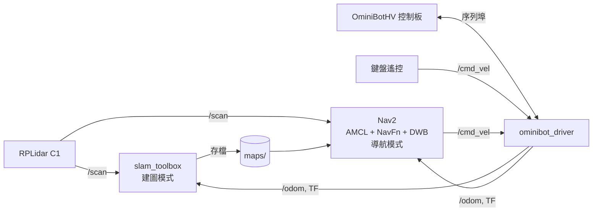

# 2026 TIRT 迷宮機器人

一台為 **2026 TIRT 迷宮機器人挑戰賽**打造的麥克納姆輪自主機器人，包含機構設計、底盤驅動、光達建圖與自主導航。全部運算都在車上的 Raspberry Pi 4 完成，並用 2D 模擬器練習和除錯。

**專案狀態：** 比賽已於 2026-11-07 結束。車子能建出品質不錯的地圖，在租屋處測試可以穩定導航（15 / 15 個目標），但比賽場地上 3 個目標都沒有到達，主要症狀是車子反覆左右移動。原因還在分析，完整紀錄見 [比賽紀錄](race_logs/2026-11-07/README.md)。

| 我想要… | 從這裡開始 |
|---|---|
| 了解比賽發生什麼事 | [比賽紀錄](race_logs/2026-11-07/README.md) |
| 現場遇到問題怎麼處理 | [比賽現場解題手冊](race_logs/2026-11-07/比賽現場解題手冊.md) |
| 沒有硬體也想跑跑看 | [模擬環境](sim/README.md) |
| 調整導航參數 | [Nav2 調參手冊](notes/nav2_tuning.md) |
| 查所有文件 | [文件索引](notes/README.md) |

## 硬體

| 項目 | 規格 |
|---|---|
| 主控 | Raspberry Pi 4 |
| 馬達控制板 | OminiBotHV（STM32F1，序列埠連接） |
| 底盤 | 四輪麥克納姆，輪徑 48 mm，輪距 115 mm，軸距 96 mm |
| 馬達 | 12 V N20，200 rpm，實測最高約 0.44 m/s |
| 感測器 | RPLidar C1 光達、控制板內建 IMU |
| 狀態顯示 | SPI OLED（SSD1306） |
| 電源 | 3S 鋰電池 |

機構的 SolidWorks 原始檔和 STEP 匯出檔在 [`CAD_files/`](CAD_files/)。

## 系統架構



建圖和導航不能同時開，因為兩者都會發布 `map -> odom`。選單切換模式時會先關掉另一個。

## 快速開始

### 不接硬體：模擬器

需要 ROS 2（Humble 或 Jazzy）。

```bash
./sim/setup_sim.sh    # 只需一次
./sim/gcs_sim.sh      # 建圖模式
./sim/gcs_sim.sh --nav  # 導航模式
```

[`sim/faults.md`](sim/faults.md) 收錄了這台車實際發生過的故障，每一個都能在模擬器重現。

### 真車：安裝

需要 Ubuntu 22.04 和 ROS 2 Humble。

```bash
# 必須先裝 git-lfs，否則 CAD 和網格檔只會是空殼
sudo apt install git-lfs && git lfs install
git clone git@github.com:lego1002/2026_TIRT.git ~/2026_TIRT

sudo apt install ros-humble-slam-toolbox ros-humble-navigation2 ros-humble-nav2-bringup

# 只在 ~/ros2_ws 編譯，不要在 repo 根目錄 colcon build
mkdir -p ~/ros2_ws/src && cd ~/ros2_ws/src
ln -s ~/2026_TIRT/car_assemble_description ~/2026_TIRT/ominibot_driver .
git clone https://github.com/Slamtec/sllidar_ros2.git
cd ~/ros2_ws && colcon build --symlink-install
```

速度校正值目前只存在 Pi 上，新環境要自己建立，否則車子會跑得比指令慢很多：

```bash
echo "cmd_linear_scale:=6.54 cmd_angular_scale:=7.43" > ~/.tirt_robot_args
```

這是這台車的校正值，換車或換馬達要用 [`tools/vel_sweep.py`](tools/vel_sweep.py) 重新量。序列埠、光達和網路的設定在 [`CLAUDE.md`](CLAUDE.md) 和 [`udev/`](udev/)、[`net/`](net/)。

### 真車：操作

SSH 進 Pi 之後，所有操作都從選單開始：

```bash
cd ~/2026_TIRT && ./menu.sh
```

1. **建圖：** `1` 開始建圖 → `2` 鍵盤遙控 → `3` 存地圖。建圖時不要用 `a/d` 原地轉。
2. **導航：** `4` 選地圖 → 確認 RViz 的紅色掃描點貼在牆上 → 點目標。
3. **結束：** `0` 全部關閉，光達馬達也會停止。

**開導航目標前，要先關掉鍵盤遙控**，否則兩者會互搶控制。

## 專案結構

| 路徑 | 內容 |
|---|---|
| `menu.sh` | 操作入口（單機模式） |
| `run_robot.sh`、`run_slam.sh`、`run_nav2.sh`、`save_map.sh` | 各功能的啟動腳本 |
| `gcs.sh`、`robotctl` | 舊的筆電＋ Pi 雙機模式，仍可使用 |
| `car_assemble_description/` | ROS 2 套件：URDF、網格、launch、RViz 設定 |
| `ominibot_driver/` | ROS 2 套件：底盤驅動、鍵盤遙控、OLED、定位狀態 |
| `sim/` | ROS 2 套件：2D 模擬器和故障重現 |
| `config/` | Nav2 和 slam_toolbox 參數 |
| `maps/` | 存好的地圖 |
| `tools/` | 診斷和校正工具，用 `python3` 直接執行 |
| `dds/`、`net/`、`pi/`、`udev/` | DDS、網路、開機服務和裝置規則 |
| `race_logs/` | 比賽紀錄 |
| `notes/`、`docs/` | 開發筆記、規則和通訊協定文件 |
| `CAD_files/` | 機構設計檔 |
| `OminiBotHV-master/` | 控制板廠商的範例和韌體 |

## 常用診斷工具

| 情況 | 工具 |
|---|---|
| 檢查供電、電池、光達、里程 | 選單 `6`（`tools/health_check.py`） |
| 錄下一趟導航 | `tools/nav_record.py` |
| 規劃不出路徑 | `tools/costmap_check.py` |
| 掃描和地圖對不上 | `tools/scan_match_check.py` |
| 車子走走停停 | `tools/cmd_vel_check.py` |
| 底盤控制問題 | `tools/motor_diag.py` |

## 已知問題

- **比賽場地導航失敗：** 車子反覆左右移動，原因尚未確定。下一步是錄下位置和速度指令，再分別驗證。
- **原地轉向影響地圖：** 用 `a/d` 原地轉時地圖會飄，建圖時先避開。
- **切換導航可能卡住：** 筆電 RViz 模式下曾發生，遇到時用選單 `0` 全關再選 `4`。
- **手搬車子後陀螺儀會短暫算錯：** 放下後等 3 分鐘再標位置。
- **校正值還沒寫回預設值：** 目前放在 `~/.tirt_robot_args`。
- **光達安裝位置還沒實測校正：** 位移參數 `laser_x`、`laser_y` 仍是 CAD 估計值。

## 開發紀錄

| 日期 | 里程碑 |
|---|---|
| 2026-07 | 機構完成，SolidWorks 匯出 URDF，轉為 ROS 2；完成底盤驅動和雙機 DDS 連線 |
| 2026-08 | 2D 模擬器；修正陀螺儀零點和序列埠失步造成的地圖彎曲 |
| 2026-09 | 修正指令和回饋 20 Hz 互撞造成的里程中斷 |
| 2026-10 | 完成速度校正；全部改到 Pi 單機執行，新增操作選單；提高馬達上限 |
| 2026-11 | 租屋處導航達到穩定；11/7 參賽並保存完整紀錄 |

## 授權

三個 ROS 2 套件的 `package.xml` 標示為 BSD，repo 目前還沒有整體的 `LICENSE` 檔。`OminiBotHV-master/`、比賽規則 PDF 和 `CAD_files/` 裡的第三方零件屬於各自的權利人。
